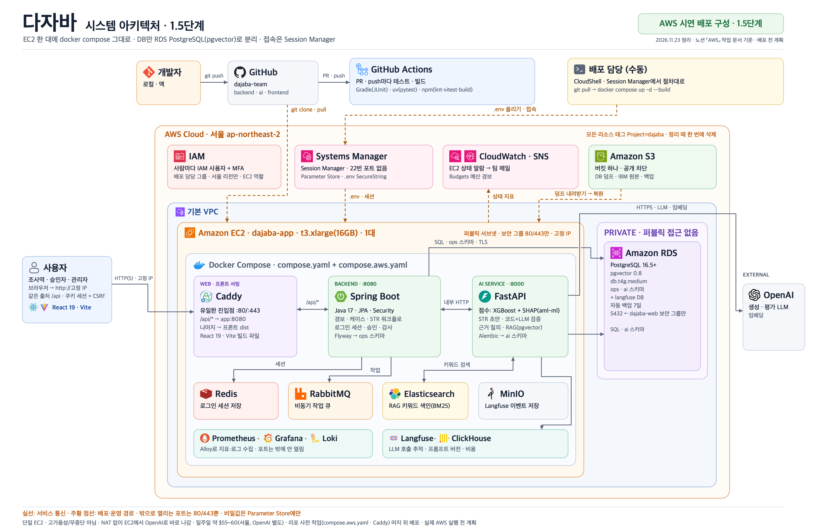
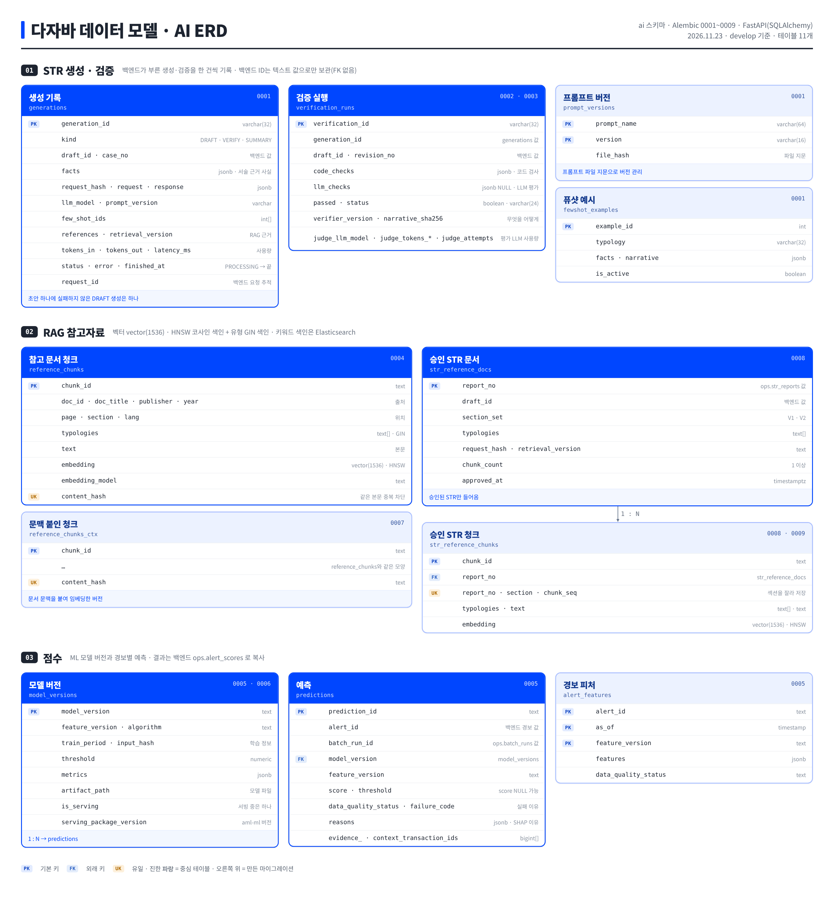
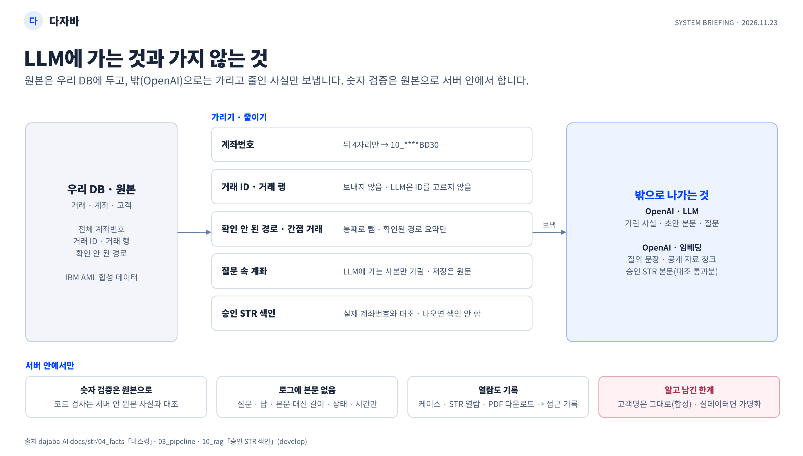
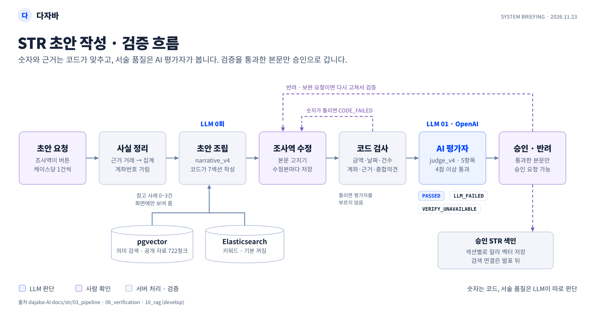
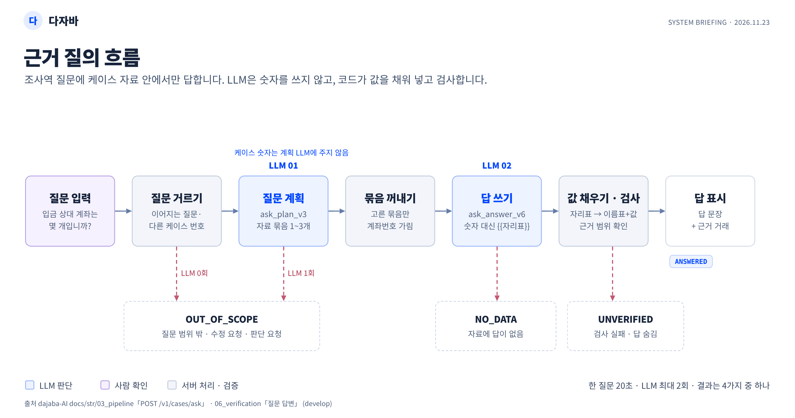
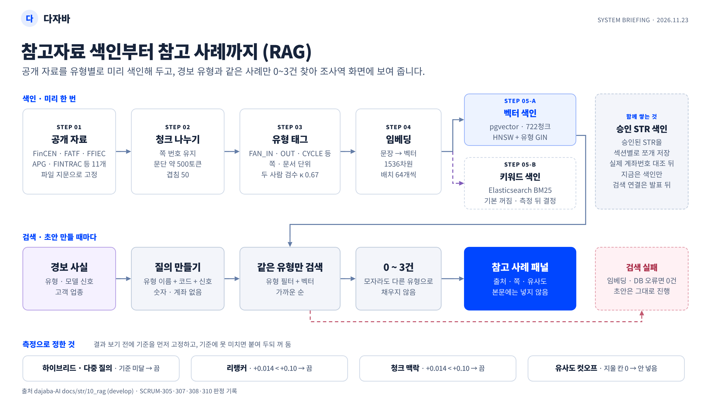

# 🔎 다자바 AI 서버 (dajaba-ai)

> 자금세탁 의심 거래 경보에 **점수와 조사 순위**를 매기고, 의심거래보고서(STR) **초안을 만들고 검증**하고, 조사역의 **질문에 근거를 붙여 답하는** FastAPI 서버


<br>

## 1. 👥 AI 담당

| 이름 | 맡은 일 |
|---|---|
| 박진희 (팀장) | STR 초안 생성·검증, 참고 사례 검색(RAG), 조사역 질문 답변, 케이스 요약 · `src/aml_ai/str/` |
| 염준영 | 경보 점수(ML), ML+DL 조사 순위 · `src/aml_ai/scoring/` · ML 패키지 `aml-ml` |

다자바는 다섯 명이 만든 프로젝트예요. 이 리포는 그중 AI 서버만 담고 있어요.

| 리포 | 내용 |
|---|---|
| [dajaba-backend](https://github.com/dajaba-team/dajaba-backend) | Spring Boot — 적재·룰 탐지·케이스·STR 워크플로·승인. 이 서버를 HTTP로 부르는 쪽 |
| [dajaba-frontend](https://github.com/dajaba-team/dajaba-frontend) | React — 조사역·승인자·관리자 화면 |
| **dajaba-ai** (여기) | FastAPI — 점수·조사 순위·STR 초안·검증·참고 사례·질문 답변 |

<br>

## 2. 📢 개요

백엔드가 룰로 찾은 경보를 넘기면, AI 서버는 **어느 경보부터 볼지** 정하는 데 필요한 점수와 순위를 주고, 조사역이 쓸 **STR 초안과 근거**를 만들어 줘요. 결과는 모두 백엔드가 저장하고 화면에 보여 줘요. AI 서버는 백엔드와 규약 JSON(HTTP)과 같은 PostgreSQL(`ops` 스키마는 읽기만, `ai` 스키마는 쓰기)로만 만나요.

| 문제 | 이 서버가 하는 일 |
|---|---|
| 룰 경보가 하루 1,500건이 넘어 다 볼 수 없음 | 경보마다 ML 점수와 이유 상위 3개 · ML+DL 결합 조사 순위 |
| STR 초안을 LLM에 맡기면 금액·날짜·건수가 틀릴 수 있음 | 숫자가 들어가는 문장은 코드가 facts로 조립하고, 코드 검사 + 평가자 LLM으로 한 번 더 확인 |
| 근거 없는 문장이 섞이면 보고서로 못 씀 | 모든 주장에 근거 거래를 연결하고, 근거 밖 인용은 검증에서 막음 |
| 비슷한 사례·공개 지침을 찾기 어려움 | 공개 자료 코퍼스에서 경보 유형에 맞는 참고 사례 0~3건 |
| 케이스를 보다 생기는 질문 | facts만 보고 답하고, 답의 숫자를 코드가 대조한 뒤 근거 거래를 붙임 |

<br>

## 3. 🛠 기술 스택

| 영역 | 사용 |
|---|---|
| AI Service |     |
| Data |      |
| Infra |    |
| Test |     |

버전은 [`pyproject.toml`](pyproject.toml) 기준이에요. LangChain 같은 프레임워크 없이 OpenAI Responses API를 직접 불러요. 모델 이름은 코드에 없고 환경 변수(`LLM_MODEL_GENERATE`·`LLM_MODEL_JUDGE`·`EMBEDDING_MODEL`)로만 정해요. 생성과 평가자는 서로 다른 모델을 써요.

<br>

## 4. ✨ 주요 기능

| 기능 | 엔드포인트 | 한 줄 |
|---|---|---|
| 경보 점수 | `POST /v1/scores` | 경보 묶음(최대 500건) → 점수·입력 품질·이유 상위 3개 |
| ML+DL 조사 순위 | `GET /v1/dl-rankings/{scan_date}` | 검증된 날짜 스냅샷의 ML 순위와 ML+DL 결합 순위 |
| STR 초안 | `POST /v1/str/drafts` | facts → 7개 섹션 초안 (narrative_v4, 문장 조립은 LLM 호출 0) |
| 초안 검증 | `POST /v1/str/verify` | 코드 검사 + 평가자 LLM 5항목 |
| 케이스 요약 | `POST /v1/cases/summary` | 케이스 요약 5줄, 금액은 코드가 대조 |
| 질문 답변 | `POST /v1/cases/ask` | 계획 → 답 → 코드 대조 → 근거 거래 연결 |
| 참고 사례 검색 | `POST /v1/references/search` | 유형 필터 + 벡터 검색으로 공개 자료 0~3건 (기본 끔) |
| 승인 STR 색인 | `POST /v1/references/str` | 승인된 STR을 참고 사례로 쌓음 (기본 끔) |

모든 `/v1/*`은 백엔드와 같은 내부 키(`X-Internal-Key`)가 있어야 해요. `GET /v1/health`만 예외예요.

### 4.1 경보 점수 (준영)

> 경보 묶음 → 거래 이력 읽기(`ops`) → `aml-ml` 피처·XGBoost 점수 → SHAP 이유 상위 3개 → `ai.predictions` 저장 → 응답

- 서빙 모델은 `aml-ml` v0.1.0rc3 (`xgb-hi-medium-r04-event-c2-31-v1`, 피처 `hi-medium-evidence31-96h-r04-event-v1`)이에요.
- 이유는 관측값·기준값·기여값으로 나눠 줘요. 기여값(SHAP)을 관측값처럼 쓰지 않아요.
- 묶음 안 경보 하나가 실패해도 그 경보만 `FAILED`로 두고 나머지는 정상 처리해요.
- HIGH·MEDIUM·LOW 등급은 AI가 정하지 않아요. 백엔드 운영 정책(CasePolicy)이 점수로 나눠요.

### 4.2 ML+DL 조사 순위 (준영)

> 날짜 → 스냅샷 manifest·해시 확인 → ML 순위 + DL 점수 결합 → 경보별 `ml_rank`·`fused_rank`·`fallback_reason`

- 검증해 둔 날짜 스냅샷(시연은 2022-09-07)만 돌려줘요. 설정이 없거나 해시가 다르면 `503 DL_RANKING_UNAVAILABLE`이에요.
- DL 근거가 하나라도 빠진 경보는 ML 순위 자리를 그대로 지켜요(`INCOMPLETE_DL_EVIDENCE`).
- 규칙은 [`docs/scoring/01_dl_investigation_ranking.md`](docs/scoring/01_dl_investigation_ranking.md)에 있어요.

### 4.3 STR 초안과 검증 (진희)

> 경보·거래 → facts 계산(통화별 집계·상대 계좌·근거 거래) → 슬롯 문장 + 허용 목록 카탈로그로 7개 섹션 조립 → 코드 검사 → 평가자 LLM → 통과해야 승인 요청 가능

- **narrative_v4**: 숫자·날짜·금액·건수·계좌가 들어가는 문장은 전부 코드가 facts로 만들어요. 나머지는 정해진 문장 카탈로그에서만 골라요. 섹션당 1,200자 이하예요.
- **유형 뒷받침 판정**: 경보 유형을 무조건 참으로 두지 않고, 거래 내역이 유형을 뒷받침하는지(뒷받침됨·미확인·불충족)를 먼저 적어요.
- **코드 검사**: 금액·날짜·건수·계좌·근거 범위·의견 유무를 facts와 대조해요.
- **평가자 LLM (judge_v4)**: 생성과 다른 모델이 5W1H·유형 일치·추측 없음·근거 없는 주장 없음·지시문 없음 5항목을 채점해요. 4점 이상이면 통과예요. 검증 때는 세 번 불러 중앙값을 써요. 평가자가 응답하지 않으면 `VERIFY_UNAVAILABLE`로 승인을 막아요.

### 4.4 질문 답변 (진희)

> 질문 → 계획 LLM(볼 facts 묶음 1~3개) → 답 LLM(답 + 인용 키) → 코드가 숫자·방향 대조 → 인용 키로 근거 거래 연결

- 답의 숫자는 코드가 facts에서 채워요(`ask_plan_v3`·`ask_answer_v6`). LLM은 거래 번호를 고르지 않아요.
- facts에 없는 값은 `NO_DATA`, 범위 밖 질문은 거절해요. 시간 예산은 전체 20초, LLM 한 번 10초예요.

### 4.5 참고 사례 검색 (진희)

> 경보 유형 → 유형 태그 필터 → 임베딩 코사인 유사도(pgvector HNSW) → 0~3건 → 화면 패널

- 맞는 유형이 없으면 0건이에요. 다른 유형으로 채우지 않아요.
- 참고 사례는 초안 본문에 넣지 않고 화면 패널에만 보여 줘요(블라인드 비교에서 뺀 쪽이 더 나았어요 — 11절).
- 다중 질의·키워드(ES)·리랭커·청크 맥락은 코드에 있지만 판정 기준을 못 넘어 **기본 끔**이에요.

<br>

## 5. 📌 아키텍처



> AWS 시연 배포 구성(1.5단계, 11/23 정리)이에요. 그림의 AWS 부분은 배포 계획이고, 로컬은 같은 구성을 Docker Compose로 띄워요.

AI 서버는 백엔드 compose 네트워크(`dajaba_default`)에 `ai` 서비스로 붙어요. 백엔드만 AI를 부르고, 프론트는 AI를 직접 부르지 않아요.

| 메서드 | 경로 | 부르는 쪽 | 규약 절 |
|---|---|---|---|
| GET | `/v1/health` | 백엔드 기동 때 (인증 없음) | 6.1 |
| POST | `/v1/scores` | 점수 배치 | 3절 |
| GET | `/v1/dl-rankings/{scan_date}` | 조사 순위 조회 | 6.1 |
| POST | `/v1/str/drafts` | 초안 생성 | 5.1 |
| POST | `/v1/str/verify` | 초안 검증 | 5.3 |
| POST | `/v1/cases/summary` | 케이스 요약 | 6.1 |
| POST | `/v1/cases/ask` | 질문 답변 | 5.4 |
| POST | `/v1/references/search` | 참고 사례 패널 | 5.5 |
| POST | `/v1/references/str` | 승인 뒤 색인 | 5.6 |

<br>

## 6. 🗂 ERD (`ai` 스키마)



Alembic 0001~0009, 테이블 11개예요. 백엔드 ID(`draft_id`·`case_no`·`alert_id` 등)는 외래 키 없이 값으로만 들고 있어요. 자세한 칸은 [`docs/shared/03_ai_schema.md`](docs/shared/03_ai_schema.md)에 있어요.

<br>

## 7. 📊 데이터 준비

| 데이터 | 내용 |
|---|---|
| 거래 | IBM 합성 AML 데이터(HI-Small·HI-Medium). 실제 은행 데이터는 쓰지 않았어요 |
| 참고자료 코퍼스 | 공개 자료 11개 문서 → 722청크 (FinCEN·FATF·FFIEC·FINTRAC·APG 등) · [`corpus/manifest.json`](corpus/manifest.json) |
| 유형 태그 | 청크마다 자금세탁 유형 태그 · 두 사람 블라인드 검수 80청크(κ FAN_IN 0.671) · 기준은 [`docs/str/rag2/`](docs/str/rag2/) |
| 표기 사전 | 코드값 → 한국어 표기 [`contracts/display_labels_v1.json`](contracts/display_labels_v1.json) |

코퍼스 다시 넣기:

```bash
uv run --frozen --extra dev --extra corpus python -m tools.ingest_corpus --verify
```

<br>

## 8. 🤖 RAG·LLM 연동



| 구성 요소 | 역할 | 코드 |
|---|---|---|
| facts | 경보·거래에서 계산한 사실. LLM이 볼 수 있는 유일한 숫자 출처 | [`str/domain/facts.py`](src/aml_ai/str/domain/facts.py) |
| 마스킹 | 계좌 원문을 가리고 LLM에 보냄 | [`str/domain/masking.py`](src/aml_ai/str/domain/masking.py) |
| 슬롯·카탈로그 | 숫자 문장과 허용 문장 (narrative_v4) | [`str/domain/display_slots.py`](src/aml_ai/str/domain/display_slots.py) · [`opinion_catalog.py`](src/aml_ai/str/domain/opinion_catalog.py) |
| 코드 검사 | 금액·날짜·건수·계좌·근거 대조 | [`str/domain/verification.py`](src/aml_ai/str/domain/verification.py) |
| 프롬프트 | 파일 하나 = 버전 하나, 지문으로 동결 | [`str/prompts/`](src/aml_ai/str/prompts/) |
| 검색 | 유형 필터 + pgvector | [`str/domain/reference_search.py`](src/aml_ai/str/domain/reference_search.py) |
| ML 연결 | `aml-ml` import만 (ML 로직은 이 리포에 없음) | [`scoring/infrastructure/aml_ml_adapter.py`](src/aml_ai/scoring/infrastructure/aml_ml_adapter.py) |

생성 기록(`ai.generations`)마다 모델·프롬프트 버전·토큰·지연·`request_id`가 남아요. 백엔드 호출 기록과 같은 `request_id`로 이어져요.

<br>

## 9. 🔀 흐름도

### STR 초안 작성·검증


### 근거 질의 (질문 답변)


### 참고자료 색인부터 참고 사례까지 (RAG)


<br>

## 10. 📁 폴더 구조

```
dajaba-ai/
├─ src/aml_ai/
│  ├─ main.py              FastAPI 생성 · 라우터 등록 · /v1/health
│  ├─ shared/              설정·에러·로그·내부 인증·버전·DB · 규약 스키마(schemas/) · LLM·임베딩 클라이언트
│  ├─ str/                 진희 — 초안·검증·요약·질문 답변·참고 사례
│  │  ├─ api/              라우터
│  │  ├─ application/      *_service.py (유스케이스)
│  │  ├─ domain/           순수 함수 — facts·슬롯·카탈로그·검증·검색 규칙
│  │  ├─ infrastructure/   DB·LLM·임베딩·ES
│  │  └─ prompts/          프롬프트 파일 (버전별)
│  └─ scoring/             준영 — 점수·조사 순위 (같은 4계층)
├─ migrations/versions/    Alembic 0001~0009 (ai 스키마)
├─ contracts/              규약 예시 JSON · 표기 사전
├─ corpus/                 참고자료 manifest
├─ tools/                  코퍼스 적재·평가·녹화·시연 도구 (tools/demo/)
├─ tests/                  contract · shared · str · scoring
└─ docs/                   설계 정본 (shared · str · scoring)
```

의존 방향은 `api → application → domain`이고, `infrastructure`는 `application`이 불러요. `str/`과 `scoring/`은 서로 import하지 않고 `shared/`로만 만나요.

<br>

## 11. 🧪 테스트·평가

### 테스트 계획

| 구분 | 무엇을 | 방법 |
|---|---|---|
| 단위 | facts 계산·슬롯·카탈로그·코드 검사·검색 규칙 | `uv run pytest` (LLM은 녹화 재생) |
| 저장소 | Alembic·저장·조회 | `uv run pytest -m db` (Testcontainers PostgreSQL) |
| 오류 주입 | 틀린 금액·날짜·건수, 근거 밖 인용을 넣은 초안이 검사에 걸리는지, 정상 초안은 통과하는지 | CI |
| 실제 LLM | 질문 답변·평가자 | `uv run pytest -m live` (담당자 터미널에서만) |
| 사람 평가 | STR 초안 블라인드, 질문 답변 근거 정확도 | 판정 기준을 결과 보기 전에 커밋 |

### 결과

| 항목 | 기준 (먼저 고정) | 결과 |
|---|---|---|
| 자동 테스트 (11/17) | 실패 0 | 5,482 통과 · 실패 0 · skip 3 (DB 테스트 57 통과) |
| STR 초안 v4 vs v2 블라인드 (새 사건 8건, 팀원 3명) | v4 우세 5/8 이상 · 틀린 문장 0 · 고칠 문장 v4 ≤ 2.0 | **v4 8승 0무 0패** · 틀린 문장 0 · 고칠 문장 평균 v2 1.21 / v4 0.38 |
| 질문 답변 평가 세트 18문항 (실제 LLM) | 범위 밖 거절 · 사실 ANSWERED · 정상 질문 UNVERIFIED 0 | 범위 밖 6/6 · 사실 8/8 · UNVERIFIED 0/12 · 최대 8.5초 |
| 질문 답변 전제가 틀린 질문 11문항 | 틀림 0 | 4/11 → **0/11** |
| 질문 답변 사각지대 16문항 | 틀림 0 | 2/16 → **0/16** · 최대 6.9초 |
| 질문 답변 근거 정확도 (사람 3명 다수결) | 12개 중 10개 이상 | **10/12** |
| 참고 사례 검색 (개발 질의 34개, 유형 필터 켬) | 상위 3건 안에 정답 | hit@3 **1.000** · 정답 없는 질의 4개 → 0건 |
| 참고 사례 추가 기법 (다중 질의 · 키워드 · 리랭커) | +0.10 이상이면 켬 | +0.059 · +0.016 · +0.014 → **기본 끔 유지** |

### 한계

- STR 블라인드는 사건 8건·평가자 3명이라 통계적 유의성은 주장하지 않아요. "먼저 정한 기준을 넘었다"까지만 말해요.
- 합성 데이터라 실무 타당성은 따로 확인해야 해요.
- 질문 답변에서 못 맞춘 2문항은 "왜 이 룰에 걸렸나" 질문이에요. 룰 발동 조건이 facts에 없어서 유형까지만 답했어요.
- 1차 블라인드에서 v4는 3/8로 기준에 못 미쳤어요. 유형 뒷받침 판정을 넣은 뒤 다시 잰 결과가 위 표예요.

<br>

## 12. 🚀 실행 방법

준비물: Python 3.12, uv, Docker. DB는 백엔드 리포의 compose가 띄워요(`app_ai` 계정과 `ai` 스키마도 백엔드가 만들어요).

```bash
git clone https://github.com/dajaba-team/dajaba-ai.git
cd dajaba-ai
uv sync
uv run alembic upgrade head
uv run uvicorn aml_ai.main:app --reload --port 8000
```

- `.env`는 팀 노션 「다자바 환경변수」의 AI 서버 부분을 저장해요. 변수 이름과 기본값은 [`docs/shared/05_dev_setup.md`](docs/shared/05_dev_setup.md)에 있고, `.env`는 커밋하지 않아요.
- compose로 띄울 때는 `docker compose up -d --build ai`예요. 백엔드 `.env`에 `AI_BASE_URL=http://ai:8000`이 있어야 해요.
- `GET /v1/health`가 `"status": "ok"`이면 준비 끝이에요. 실제 모델로 점수를 내려면 `scoring_mode`가 `model`이어야 해요. rc3 체크포인트 연결은 [`docs/shared/02_ml_package.md`](docs/shared/02_ml_package.md) 「rc3 로컬·시연 전용 설정」을 따라요.
- 참고 사례·승인 STR 색인·키워드 검색·추적은 기본으로 꺼져 있어요(`RAG_ENABLED`·`RAG_REFERENCE_SEARCH_ENABLED`·`STR_INDEX_ENABLED`·`LANGFUSE_ENABLED`).

테스트:

```bash
uv run pytest
uv run pytest -m db
uv run ruff check .
uv run mypy
```

`uv run pytest -m live`는 실제 LLM을 불러 비용이 들어요. 기본 실행에서는 빠져 있어요.

<br>

## 13. 📚 주요 문서

| 문서 | 내용 |
|---|---|
| [`docs/README.md`](docs/README.md) | 설계 문서 지도 (읽는 순서) |
| [`docs/shared/00_server_rules.md`](docs/shared/00_server_rules.md) | 폴더 경계·에러 JSON·내부 인증 |
| [`docs/shared/01_contracts.md`](docs/shared/01_contracts.md) | 규약 ↔ `schemas/` ↔ 예시 JSON |
| [`docs/shared/02_ml_package.md`](docs/shared/02_ml_package.md) | `aml-ml` 패키지 계약 · rc3 설정 |
| [`docs/shared/03_ai_schema.md`](docs/shared/03_ai_schema.md) | `ai` 스키마 |
| [`docs/shared/05_dev_setup.md`](docs/shared/05_dev_setup.md) | 환경 변수·로컬 실행 |
| [`docs/str/03_pipeline.md`](docs/str/03_pipeline.md) | 초안·검증·요약 파이프라인 |
| [`docs/str/04_facts.md`](docs/str/04_facts.md) | facts 계산 규칙 |
| [`docs/str/05_prompts.md`](docs/str/05_prompts.md) | 프롬프트 · narrative_v4 |
| [`docs/str/06_verification.md`](docs/str/06_verification.md) | 코드 검사 · 평가자 |
| [`docs/str/09_decisions.md`](docs/str/09_decisions.md) | 결정 기록 |
| [`docs/str/10_rag.md`](docs/str/10_rag.md) | RAG |
| [`docs/scoring/01_dl_investigation_ranking.md`](docs/scoring/01_dl_investigation_ranking.md) | ML+DL 조사 순위 |
